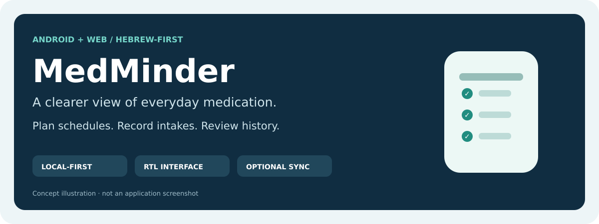
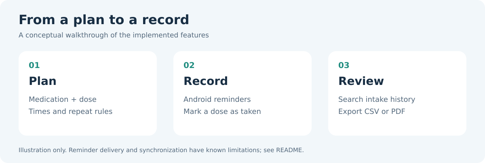
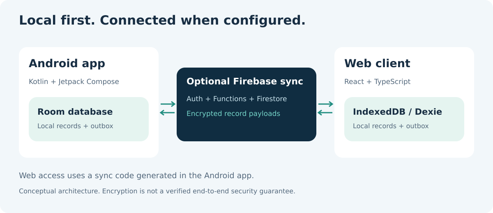

[עברית · הסיור החזותי](README.md)

<p align="center">
  
</p>

<p align="center">
  <strong>One place to plan medication schedules, record intakes, and review what happened.</strong><br>
  Native Android · Companion Web · Hebrew &amp; RTL · Local-first storage
</p>

<p align="center">
  <a href="#what-is-medminder">Overview</a> ·
  <a href="#what-you-can-do">Features</a> ·
  <a href="#how-it-fits-together">Architecture</a> ·
  <a href="#run-it-locally">Get started</a> ·
  <a href="#status-and-important-limitations">Status &amp; limitations</a>
</p>

<div dir="rtl">

**בקצרה:** MedMinder הוא פרויקט לניהול תרופות בעברית, עם אפליקציית Android וממשק Web נלווה. אפשר להגדיר זמני נטילה, לתעד נטילות ולצפות בהיסטוריה. הנתונים נשמרים קודם במכשיר, ואפשר להגדיר סנכרון בענן. הגישה מהדפדפן נעשית באמצעות קוד שמופק באפליקציית Android.

זהו פרויקט תוכנה, לא מערכת רפואית מאושרת ולא תחליף להנחיות רפואיות. יש מגבלות ידועות בתזכורות ובסנכרון; אין להסתמך עליו כאמצעי היחיד לזכירת נטילות. התמונות כאן הן איורי הסבר, לא צילומי מסך.

</div>

## What is MedMinder?

Keeping track of medication involves more than a list of names: **what is scheduled, what was taken, and what needs a closer look?** MedMinder brings those records together in a Hebrew-first interface.

The repository contains three connected parts:

- **An Android application** for medication management, local reminders and intake records.
- **A companion Web client** for working with the same dataset from a browser.
- **An optional Firebase backend** for authentication, session management and synchronization.

This is source code you can inspect and build. This README does **not** claim a verified public deployment, published store release, clinical validation or production-readiness.

## What you can do

| Area | Implemented in the repository |
| --- | --- |
| **Medication plans** | Store medication name, dose, food relation, notes, dates and scheduling information; deactivate and restore medications. |
| **Flexible schedules** | Model fixed times, hour intervals and day intervals, with weekday/date controls where supported. See the Web date-filtering limitation below. |
| **Daily tracking** | View dose events and record a dose as taken; support as-needed / one-off intake records. |
| **Android reminders** | Schedule notifications with `AlarmManager`. Delivery depends on permissions, device behavior and the current scheduling limitations. |
| **History & reports** | Search and filter intake records, edit intake time, soft-delete records and export CSV/PDF reports. |
| **Audit trail** | Keep change records and flag backdated changes using rules. This is not AI-based medical analysis. |
| **Hebrew-first interface** | RTL layouts, Hebrew typography, large controls, font-size and contrast options. |
| **Device access controls** | Android PIN/biometric features; optional cloud access through app-generated sync codes. |
| **Local-first data** | Android Room and browser IndexedDB storage, with an outbox for optional synchronization. |



### A typical journey

1. **Create a plan on Android.** Enter a medication and its schedule.
2. **Record what happened.** Use the daily view to record an intake and review its status.
3. **Look back.** Search the history or export a report for your own review.
4. **Optionally connect a browser.** Configure Firebase, generate a sync code on Android and use it to join that dataset on the Web.

The Web client is a companion, not an independent public sign-up flow. Android provides the native reminder implementation; browser notifications are not presented here as equivalent.

## How it fits together



| Layer | Technologies | Responsibility |
| --- | --- | --- |
| Android | Kotlin, Jetpack Compose, Hilt, Room, AlarmManager | Native UI, local persistence, scheduling and reminders |
| Web | React 19, TypeScript, Vite, Dexie, Zustand, TanStack Query, Zod | Browser UI, IndexedDB data, validation and sync state |
| Backend | Firebase Anonymous Authentication, Firestore, TypeScript Cloud Functions | Dataset access, Web sessions, revocation and encrypted record storage |
| Reporting | CSV export and jsPDF in the Web client | Portable intake/history reports |

### Synchronization in plain language

Writes go to the local database first. When configured, synchronization pulls cloud records, merges them and pushes queued local changes. Record timestamps drive conflict resolution; soft-deletion markers propagate deletions.

The shared record types are `MEDICATION`, `DOSE_EVENT` and `HIDDEN_INTAKE_LOG`. User profile data is not part of that cloud record set. Foreground Web synchronization runs periodically; this is **not a guarantee of continuous background delivery**.

Payloads use AES-GCM encryption and HKDF-derived keys, but that alone does not establish end-to-end confidentiality. See the security notes below before storing real health information.

## Run it locally

### 1. Get the source

```bash
git clone https://github.com/razmazlih/medminder.git
cd medminder
```

### 2. Android

- Open the repository in Android Studio with **JDK 17** and Android SDK 35 installed.
- The app targets Android 35 and supports **Android 8.0 / API 26 and later**.
- For Firebase integration, supply your own `app/google-services.json` and follow the [Firebase setup guide](docs/firebase/README.md).
- Run the `app` configuration on an emulator or device. Check notification and alarm permissions on the device.

Do not commit local Firebase configuration, credentials or real patient data.

### 3. Web

Use a Node.js version compatible with Vite 8, such as Node **22.12+**.

```bash
cd web
npm ci
cp .env.example .env
# Fill .env with the Firebase Web configuration for your own project.
npm run dev
```

Open the local URL printed by Vite. Real cloud access requires the corresponding Firebase setup and an Android-generated sync code. For isolated development, the repository also includes a fake-cloud adapter selected by `VITE_USE_FAKE_CLOUD=1`; it is a test aid, not a persistent hosted service.

For full setup details, see [Web documentation](web/README.md).

### 4. Optional backend

The Functions package declares **Node.js 20**. Use the package-specific runtime when building or deploying the backend.

```bash
cd functions  # from the repository root
npm ci
npm run build
```

Enable Anonymous Authentication, configure Firestore rules and deploy the callable functions into **your own** Firebase project using the [backend guide](docs/firebase/README.md). Deployment can incur charges and is not required merely to read or inspect this repository.

## Checks available in the repository

```bash
# Web, from web/
npm run typecheck
npm run lint
npm test
npm run build

# Browser tests; install the Chromium test browser first
npx playwright install chromium
npm run test:e2e

# Android, from the repository root
./gradlew testDebugUnitTest
./gradlew connectedDebugAndroidTest  # requires a running emulator/device
```

The repository contains Web unit/integration tests, Playwright scenarios and Android unit/instrumented tests. **Their presence is not proof that they pass in every environment.** Playwright uses a fake-cloud configuration, so it does not validate production Firebase behavior or real-device reminder reliability. During documentation work, the Web production build (including TypeScript) and all 52 Vitest tests across 14 files passed locally. The build reported a large-chunk warning. Android tests, browser E2E tests and live Firebase behavior were not verified.

## Status and important limitations

> **Use synthetic data while evaluating.** MedMinder is not a medical device or medical advice, does not check drug interactions, and should not be your only reminder system. Follow your clinician's instructions for medication decisions.

These are source-review findings, not claims that every failure has been reproduced on a device:

- **Reminder horizon:** events are generated only a few days ahead in key flows. A reliable automatic refill beyond that horizon has not been established, so reminders may stop if the app is not reopened. Test long-running behavior before relying on it.
- **Sync completeness:** the Web pull path limits a query to 1,000 records without complete pagination. Larger datasets may not synchronize fully. Some errors may also be caught without clearly surfacing an incomplete sync to the user.
- **Date filtering:** the Web fixed-time intake view does not consistently apply weekday and start/end-date rules. Review displayed events against the intended schedule.
- **Encryption boundary:** the sync code is sent to a backend callable and also used in data-key derivation. Do not interpret encrypted cloud payloads as a verified end-to-end encryption guarantee against the server.
- **Local privacy:** browser records are stored in IndexedDB; Android uses Room without a demonstrated database-encryption layer. OS protections and access controls are separate from record encryption. Notification content should also be evaluated on a locked device.
- **Scope:** no iOS client, clinical decision support, multi-patient/caregiver account system or healthcare-provider integration is established by this repository.

For implementation details, start with the [Web sync adapter](web/src/sync/firebaseCloudAdapter.ts), [sync engine](web/src/sync/syncEngine.ts), [cryptography module](web/src/core/crypto.ts), [Functions](functions/src/index.ts) and [Firestore rules](firestore.rules).

## Explore the code

```text
medminder/
├── app/                   Native Android application
├── web/                   React companion client and browser tests
├── functions/             Firebase callable functions
├── docs/                  Architecture, setup and explanatory artwork
├── scripts/               Deployment helpers
├── firestore.rules        Cloud access rules
└── firebase.json          Firebase project configuration
```

- [Architecture](docs/architecture.md): components and data flow.
- [Project build process](docs/project-build-process.md): implementation background.
- [Web setup](web/README.md): client configuration and commands.
- [Firebase setup](docs/firebase/README.md): backend provisioning.
- [Artwork notes](docs/images/README.md): what the illustrations represent.

## Contributing & reuse

Useful next steps include strengthening long-running reminders, paginated sync, date-rule parity and privacy guarantees, with tests that cover real failure conditions. Keep bug reports free of health records, sync codes and credentials; use synthetic examples.

No license file is currently included. A publicly readable repository does not by itself grant permission to redistribute or reuse the code; clarify licensing with the owner first.
