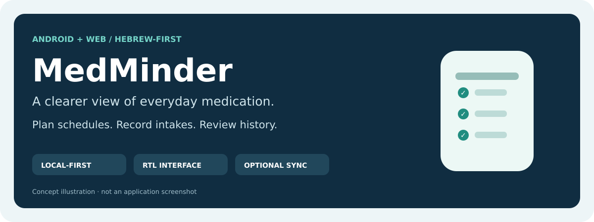
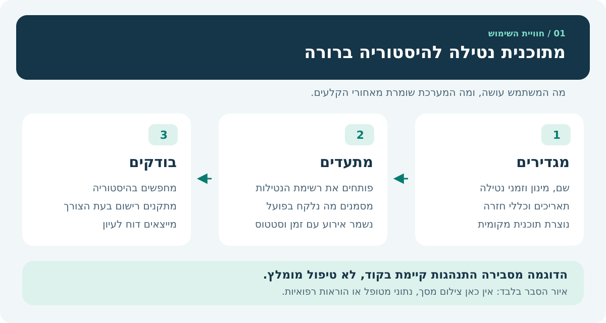
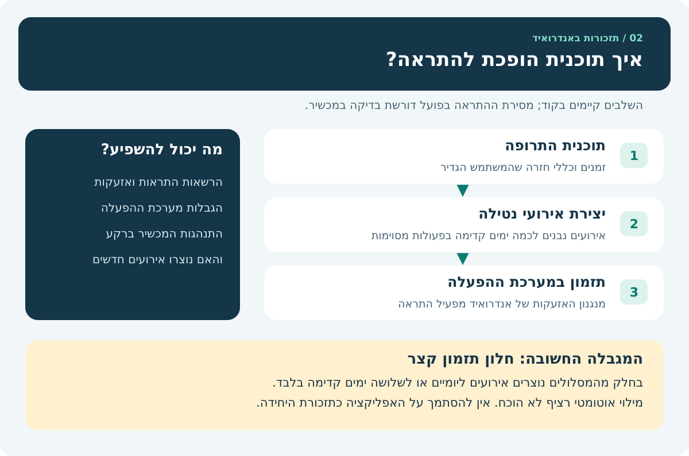
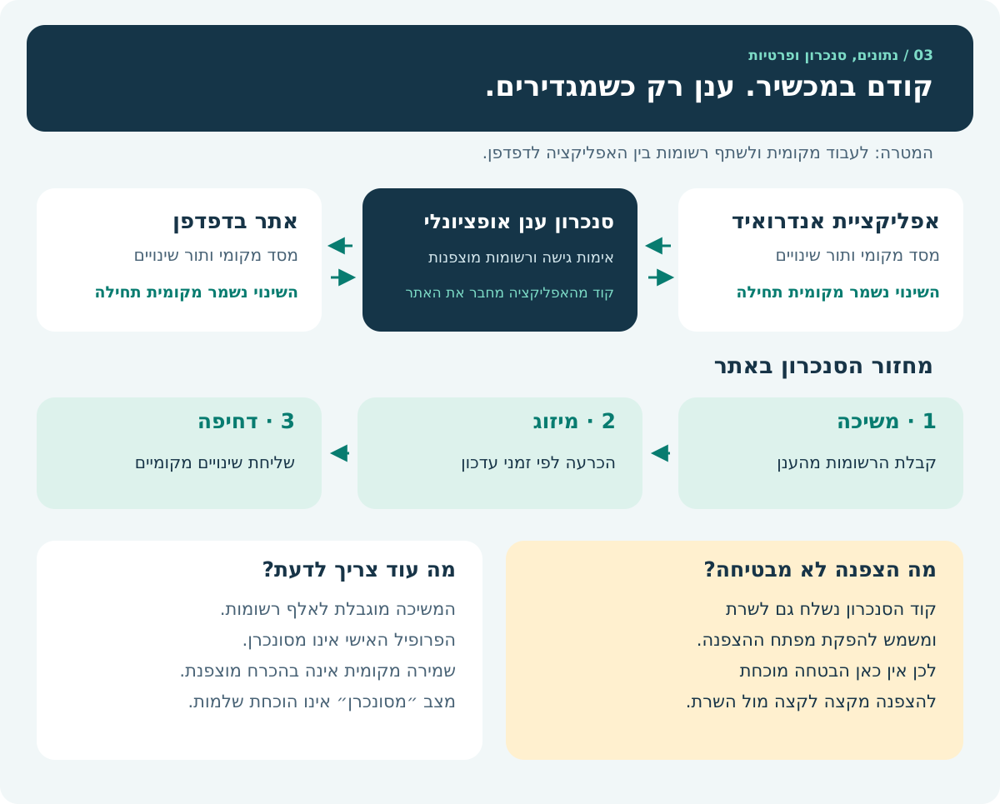

<p align="center">
  
</p>

<div dir="rtl">

# MedMinder · להבין את שגרת התרופות

**מה מתוכנן, מה נלקח ומה כדאי לבדוק שוב?** MedMinder מרכזת את המידע הזה באפליקציית Android ובאתר נלווה, עם ממשק עברי ושמירה מקומית של הנתונים.

זהו מאגר קוד הכולל אפליקציה, אתר ורכיבי סנכרון. הסיור הבא מסביר איך החלקים עובדים יחד, בלי צורך להכיר את הקוד מראש.

[English guide](README.en.md) · [התיעוד הטכני](docs/architecture.md) · [התקנת האתר](web/README.md) · [הגדרת הענן](docs/firebase/README.md)

> **לפני שמתחילים:** האיורים הם תרשימי הסבר של הקוד, לא צילומי מסך ולא מידע רפואי אמיתי. הפרויקט אינו מוצר רפואי מאושר, אינו נותן המלצות טיפול ואין להסתמך עליו כתזכורת היחידה לנטילת תרופות. מגבלות התזכורות והסנכרון מוסברות בהמשך.

## 1. מה עושים עם המערכת?

המערכת מפרידה בין **תוכנית** לבין **מה שקרה בפועל**. הגדרת שעה לנטילה אינה אומרת שהתרופה נלקחה; רישום הנטילה יוצר תיעוד נפרד שאפשר לחזור אליו.



### שלושה מושגים שמסדרים את התמונה

- **תרופה ותוכנית:** שם, מינון, הערות, קשר לאוכל וזמני נטילה. בקוד קיימים מסלולי שעות קבועות, מרווחי שעות ומרווחי ימים.
- **אירוע נטילה:** רשומה עם זמן וסטטוס, למשל ממתין, נלקח או הוחמץ. יש גם תמיכה ברישום חד־פעמי ולפי צורך.
- **היסטוריה ויומן שינויים:** אפשר לחפש, לסנן, לתקן זמן נטילה ולמחוק רישום באופן לוגי. מנגנון מבוסס כללים מתעד גם שינויים בדיעבד; זה אינו ניתוח רפואי באמצעות AI.

**דוגמה בלי פרטים רפואיים:** מגדירים פריט לדוגמה לשעה מסוימת, מסמנים שהנטילה בוצעה, ואז רואים בהיסטוריה את האירוע שנרשם. אם טעינו בזמן, תיקון הרישום אינו שינוי של הנחיות הטיפול.

### מה עוד קיים בקוד?

- השבתה ושחזור של תרופות.
- ייצוא היסטוריה ודוחות לקובצי CSV ו־PDF.
- ממשק עברי מימין לשמאל, בקרות גדולות ואפשרויות גודל טקסט וניגודיות.
- אפשרויות PIN וביומטריה ב־Android.
- אתר נלווה שניגש לאותו מאגר באמצעות קוד שמופק באפליקציה, לא תהליך הרשמה ציבורי עצמאי.

## 2. איך נוצרות התזכורות?

תזכורת אינה רק שעה שמופיעה במסך. האפליקציה צריכה לייצר אירוע עתידי, לתזמן אותו במערכת ההפעלה ולקבל את ההרשאות המתאימות.



**מה מוכח בקוד:** שימוש ב־`AlarmManager` ותהליכים ליצירת אירועים והתראות ב־Android.

**מה עדיין לא מוכח:** אמינות רציפה לאורך ימים ללא פתיחת האפליקציה. מסלולים מרכזיים מייצרים אירועים ליומיים או לשלושה ימים קדימה; לא התבסס מנגנון מילוי רציף שמבטיח המשכיות מעבר לכך. זהו ממצא מסקירת קוד, לא תוצאה של ניסוי ממושך בטלפון.

האתר אינו מוצג כאן כתחליף למנגנון ההתראות המקומי של Android. כדאי לבדוק בנפרד גם אילו פרטים מוצגים על מסך נעול.

## 3. איפה הנתונים נמצאים ואיך הם עוברים?

העיקרון הוא **שמירה מקומית תחילה**: האפליקציה משתמשת ב־Room, והאתר ב־IndexedDB דרך Dexie. כשהסנכרון מוגדר, תור שינויים מאפשר למערכת לנסות להעביר את הרשומות בין המכשירים דרך Firebase.



### לקרוא את התרשים צעד־צעד

1. **שומרים מקומית:** הפעולה נכתבת למאגר המקומי. פעולות שדורשות סנכרון נכנסות לתור.
2. **משתפים גישה:** קוד שמופק באפליקציה משמש לחיבור האתר לאותו מאגר דרך פונקציית שרת.
3. **מושכים וממזגים:** האתר מושך רשומות ומכריע בין גרסאות לפי זמני העדכון. סימוני מחיקה מאפשרים להעביר גם מחיקות לוגיות.
4. **דוחפים שינויים:** השינויים המקומיים שבתור נשלחים לענן. הסנכרון באתר פועל באופן מחזורי בזמן שהיישום פעיל; זו אינה הבטחה לפעילות רציפה ברקע.

סוגי הרשומות המסונכרנות הם תרופות, אירועי נטילה ויומן נטילות פנימי. **פרופיל המשתמש אינו חלק מהקבוצה הזו.**

### הצפנה, בלי הבטחות מוגזמות

מטעני הרשומות משתמשים ב־AES-GCM ובמפתחות שנגזרים באמצעות HKDF. אבל קוד הסנכרון, שממנו נגזר המפתח, מועבר גם לשרת. לכן אין בסיס להציג את המימוש כהצפנה מוכחת מקצה לקצה שמגינה מפני השרת עצמו.

גם הצפנת הרשומות בענן אינה אומרת שהעותק המקומי מוצפן: באתר יש רשומות ב־IndexedDB, וב־Android מסד Room ללא שכבת הצפנת מסד שהוכחה בסקירה. הגנות מערכת ההפעלה ונעילת האפליקציה הן שכבות נפרדות.

## 4. מה נמצא בכל חלק של הריפו?

| חלק | הטכנולוגיות המרכזיות | מה הוא עושה |
| --- | --- | --- |
| `app/` | Kotlin, Jetpack Compose, Hilt, Room | אפליקציית Android, אחסון מקומי, תזמונים והתראות |
| `web/` | React 19, TypeScript, Vite, Dexie, Zustand | האתר הנלווה, אחסון בדפדפן וממשקי ניהול והיסטוריה |
| `functions/` | TypeScript, Firebase Functions | חיבור למאגר, ניהול חיבורי Web וביטול גישה |
| `firestore.rules` | Firebase Firestore | כללי גישה לרשומות הענן |
| `docs/` | תיעוד ואיורים | ארכיטקטורה, הוראות התקנה והסברים |

## 5. רוצים להריץ בעצמכם?

לבדיקה ראשונית השתמשו **בנתוני דוגמה בלבד**. לא צריך להזין מידע רפואי אמיתי כדי ללמוד את המערכת.

</div>

```bash
git clone https://github.com/razmazlih/medminder.git
cd medminder
```

<div dir="rtl">

**Android:** פותחים ב־Android Studio עם JDK 17 ו־SDK 35. המינימום הוא Android 8.0 / API 26. להגדרת Firebase משתמשים בקובץ `app/google-services.json` של הפרויקט שלכם ובהוראות [ההתקנה](docs/firebase/README.md). אין להעלות קובצי תצורה מקומיים או סודות לריפו.

**האתר:** משתמשים ב־Node התואם ל־Vite 8, למשל 22.12 ומעלה.

</div>

```bash
cd web
npm ci
cp .env.example .env
# Configure your own Firebase project in .env.
npm run dev
```

<div dir="rtl">

פותחים את הכתובת המקומית שמודפסת בטרמינל. חיבור אמיתי דורש Firebase מוגדר וקוד סנכרון מהאפליקציה. לבדיקות מבודדות קיים מתאם ענן מדומה עם `VITE_USE_FAKE_CLOUD=1`; הוא כלי בדיקה, לא שירות ענן קבוע.

חבילת הפונקציות מצהירה בנפרד על Node 20. [הוראות הענן](docs/firebase/README.md) מפרטות אימות אנונימי, כללי גישה ופונקציות. פריסה לשירות ענן עשויה לעלות כסף; אין צורך לפרוס רק כדי לקרוא את הקוד.

## 6. בדיקות, שקיפות ומה נשאר לשפר

בבדיקה המקומית של גרסת הקוד שעליה מבוסס התיעוד, **בניית Web כולל TypeScript עברה, ו־52 בדיקות עברו ב־14 קבצים**. התקבלה אזהרה על קובץ JavaScript גדול. לא הורצו כאן בדיקות מכשיר Android או בדיקות דפדפן מקצה לקצה בהצלחה. אין להסיק מבדיקות היחידה שהתזכורות או Firebase אמינים בייצור.

פקודות לבדיקה עצמאית מתוך `web/`:

</div>

```bash
npm run typecheck
npm run lint
npm test
npm run build
npx playwright install chromium
npm run test:e2e
```

<div dir="rtl">

בדיקות Playwright משתמשות בענן מדומה, לא בענן הייצור. [המדריך באנגלית](README.en.md) כולל גם פקודות לבדיקות Android.

<a id="status-and-important-limitations"></a>

### מגבלות שחשוב להכיר

- **תזכורות:** חלון יצירת האירועים קצר; המשכיות לאורך ימים ללא פתיחת האפליקציה דורשת תיקון ואימות.
- **שלמות סנכרון:** מסלול המשיכה באתר מוגבל ל־1,000 רשומות ללא דפדוף מלא. חלק משגיאות הסנכרון עלולות שלא להשתקף היטב במצב המוצג למשתמש.
- **כללי תאריכים:** בתצוגת הנטילות באתר, המסלול של שעות קבועות אינו מחיל בעקביות את כללי ימי השבוע ותאריכי ההתחלה והסיום.
- **פרטיות:** ההצפנה אינה ערובה לסודיות מול השרת, ויש לבדוק גם הגנה על אחסון מקומי ועל תוכן התראות.
- **גבולות המוצר:** הריפו אינו מוכיח גרסת iOS, מערכת מטפלים וריבוי מטופלים, בדיקת אינטראקציות בין תרופות או אינטגרציה עם ספקי בריאות. אין כאן טענה לפריסה ציבורית מאומתת או לגרסת חנות פעילה.

אלה נקודות ממוקדות להמשך פיתוח, ולא תכונות שמוצגות כאילו כבר הושלמו.

## להעמיק בקוד, כשמתחשק

- [ארכיטקטורה](docs/architecture.md) · [תהליך הבנייה](docs/project-build-process.md)
- [מנוע הסנכרון](web/src/sync/syncEngine.ts) · [מתאם Firebase](web/src/sync/firebaseCloudAdapter.ts)
- [רכיב ההצפנה](web/src/core/crypto.ts) · [פונקציות השרת](functions/src/index.ts)
- [כללי גישה](firestore.rules) · [מקור ומשמעות האיורים](docs/images/README.md)

**רישוי:** כרגע אין קובץ רישיון. עצם האפשרות לצפות בריפו ציבורי אינה רשות אוטומטית להפיץ או להשתמש מחדש בקוד; יש לברר רישוי עם הבעלים.

</div>
