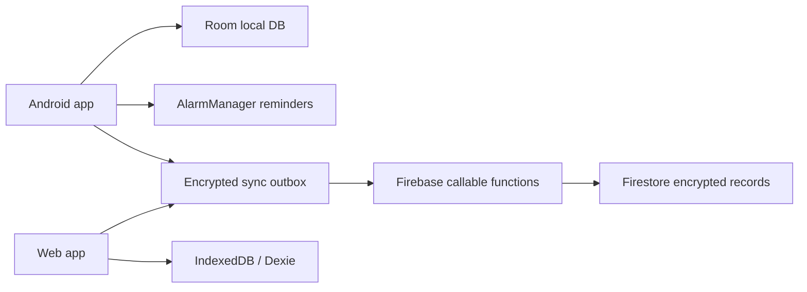

# MedMinder - תיעוד תהליך בנייה

## מטרת הפרויקט
MedMinder הוא מנהל תרופות בעברית שמטרתו לעזור למשתמשים לזכור נטילות, לתעד מה נלקח בפועל, ולהציג היסטוריה אמינה גם כשיש שימוש בכמה מכשירים.

הבעיה המרכזית שנפתרת כאן:
- שכחה או דחייה של נטילת תרופות.
- קושי לעקוב אחרי היסטוריית נטילות לאורך זמן.
- צורך בגיבוי וסנכרון בלי לחשוף מידע רפואי רגיש.
- צורך בממשק עברי, נגיש וברור גם למשתמשים מבוגרים.

## הפתרון בקצרה
המערכת בנויה בגישת local-first: כל פעולה נשמרת קודם במכשיר, ורק לאחר מכן מסתנכרנת לענן אם המשתמש הפעיל גיבוי.

הפתרון כולל:
- אפליקציית Android Native לניהול תרופות, תזכורות ונטילות.
- Web client לצפייה ועדכון נתונים ממחשב או דפדפן.
- Firebase Functions ו-Firestore כשכבת חיבור וסנכרון.
- הצפנת payload רפואי מקצה לקצה לפני שמירה בענן.
- ייצוא דוחות CSV/PDF והיסטוריית פעולות פנימית.



## רכיבי המערכת

| רכיב | תפקיד | טכנולוגיות |
| --- | --- | --- |
| Android app | חוויית המשתמש הראשית, תזכורות, היסטוריה, דוחות | Kotlin, Jetpack Compose, Hilt, Room, AlarmManager |
| Web app | ממשק דפדפן מסונכרן לניהול וצפייה | React, TypeScript, Vite, Dexie, Zustand |
| Sync backend | אימות, פתיחת dataset, ניהול session והרשאות | Firebase Auth Anonymous, Cloud Functions, Firestore Rules |
| הצפנה | הגנה על מידע רפואי לפני הענן | HKDF SHA-256, AES-GCM |
| בדיקות | שמירה על לוגיקת תזמון, סנכרון וזרימות משתמש | JUnit, Vitest, Playwright |

## איך זה פותר את הבעיה
- תזכורות מדויקות: חישוב מועדי נטילה ותזמון התראות גם אחרי reboot או שינוי שעה.
- מעקב יומי: מסך "היום" מציג מה צריך לקחת ומה כבר טופל.
- היסטוריה ודוחות: המשתמש יכול לבדוק נטילות קודמות ולייצא CSV/PDF.
- סנכרון בטוח: אפשר לעבוד מכמה מכשירים בלי לשמור מידע רפואי גלוי בענן.
- נגישות: עברית מלאה, RTL, מצב למבוגרים, כפתורים גדולים וניגודיות גבוהה.

## תהליך הבנייה

1. אפיון הבעיה והמשתמשים:
   הוגדר מוצר שממוקד בתרופות, נטילות, תזכורות, עברית מלאה, נגישות וגיבוי אופציונלי.

2. בניית ליבת Android:
   נבנו מודלים של תרופות, מועדי נטילה, היסטוריה והגדרות. הנתונים נשמרים ב-Room, והמסכים בנויים ב-Jetpack Compose.

3. מנוע תזמון ותזכורות:
   `ScheduleEngine` מחשב תאריכים ושעות לפי שעות קבועות, מרווחי שעות או מרווחי ימים. `AlarmManager` מתזמן התראות מדויקות ככל שהמערכת מאפשרת.

4. אמינות נתונים:
   כל Dose Event נשמר עם סטטוס כמו pending/taken/skipped/missed. בעת פתיחת האפליקציה, אתחול מכשיר או שינוי זמן, המערכת מייצרת אירועים עתידיים, מסמנת החמצות ומתזמנת מחדש.

5. שכבת סנכרון:
   שינוי מקומי נכנס ל-outbox. בזמן סנכרון המערכת מושכת רשומות מהענן, ממזגת לפי `updatedAt`, ואז דוחפת שינויים חדשים.

6. Web client:
   נבנה ממשק React שמתחבר באמצעות sync code מהאפליקציה. הנתונים נשמרים מקומית ב-IndexedDB ומסתנכרנים לענן באותה שיטת pull-merge-push.

7. אבטחה ופרטיות:
   קוד הסנכרון משמש לגזירת מפתח נתונים. Firestore שומר `iv` ו-`ciphertext`, ולא את תוכן התרופות הגולמי. גיבוי ענן הוא אופציונלי.

8. דוחות ובקרה:
   נוספו דוחות CSV/PDF, יומן פנימי לשינויים ויכולת לזהות פעולות חריגות כמו שינוי זמן נטילה לאחור.

## זרימת משתמש עיקרית
- Onboarding: הגדרות ראשוניות, שם משתמש, פורמט שעה ומצב תצוגה.
- היום: סימון לקחתי/דחיתי/דילגתי, תרופות לפי צורך ותרופות חד-פעמיות.
- תרופות: הוספה, עריכה, השבתה, שחזור ומחיקה.
- היסטוריה: סינון, עריכת סטטוס/שעה, מחיקה וייצוא דוחות.
- הגדרות: נגישות, נעילת אפליקציה, קוד סנכרון וגיבוי ענן.

## איך מריצים ובונים

### Android
דרישות: Android Studio, JDK 17, Android SDK 35.

```bash
./gradlew :app:assembleDebug
./gradlew :app:testDebugUnitTest
```

להפעלת Firebase ב-Android:
- להוסיף `google-services.json` אל `app/google-services.json`.
- להפעיל Anonymous Auth ו-Firestore בפרויקט Firebase.

### Web
דרישות: Node.js, npm.

```bash
cd web
npm install
npm run dev
npm run build
npm test
```

להרצה מול Firebase:
- להעתיק `web/.env.example` ל-`web/.env`.
- למלא ערכי Firebase Web SDK.

להרצה מקומית/בדיקות בלי Firebase אמיתי:

```env
VITE_USE_FAKE_CLOUD=1
```

### Firebase Functions
דרישות: Node 20 ו-Firebase CLI מחובר לפרויקט.

```bash
cd functions
npm install
npm run build
```

פריסה מלאה של functions וכללי Firestore:

```bash
./scripts/deploy_firebase.sh
```

## התאמה לסביבת הפיתוח
הפרויקט מתאים לעבודה מקומית על MacBook M3 Max עם 32GB RAM:
- Gradle כבר מוגדר עם `org.gradle.jvmargs=-Xmx4g`.
- מומלץ להריץ Android Studio, אמולטור, Web dev server ו-Firebase emulator במקביל רק כשצריך.
- להרצת בדיקות כבדות מומלץ לסגור build/watch processes לא נחוצים כדי להשאיר זיכרון לאמולטור ול-TypeScript.

## נקודות איכות
- Offline-first: האפליקציה שימושית גם בלי ענן.
- Privacy-first: מידע רפואי מוצפן לפני Firestore, וגיבוי מערכת Android כבוי עם `allowBackup=false`.
- נגישות: RTL, עברית, כפתורי מגע גדולים, מצב ניגודיות גבוהה ומצב תצוגה למבוגרים.
- אמינות: תזמון מחדש אחרי reboot/timezone/time change.
- בדיקות קיימות ללוגיקת תזמון, הצפנה, סנכרון, מסכים וזרימות E2E.

## כיווני המשך
- חיזוק בדיקות אינטגרציה מול Firebase Emulator.
- שיפור מסכי onboarding והסבר sync code למשתמשים לא טכניים.
- ניטור כשלים בסנכרון עם הודעות משתמש ברורות יותר.
- הוספת תיעוד קצר לצילומי מסך/דמו עבור הצגה.
